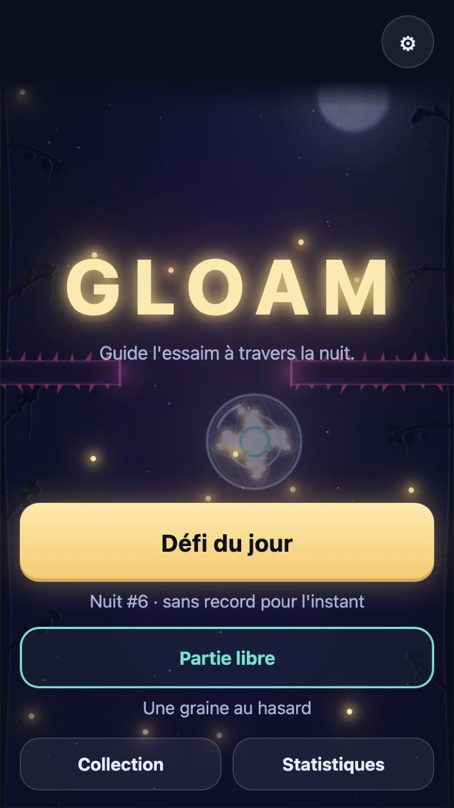
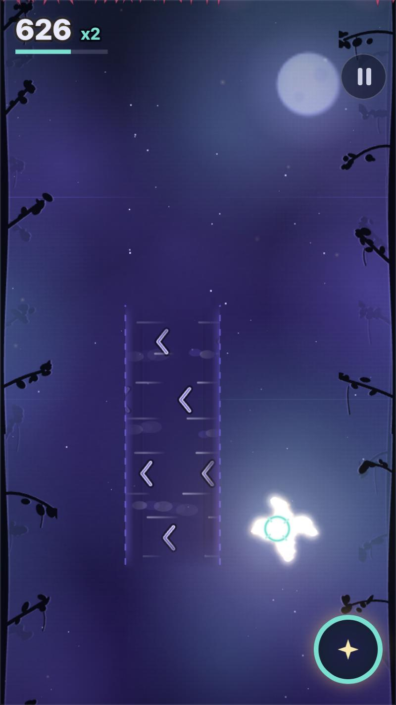
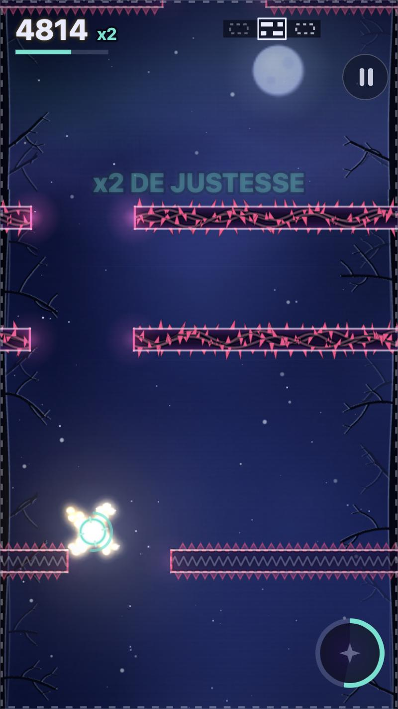
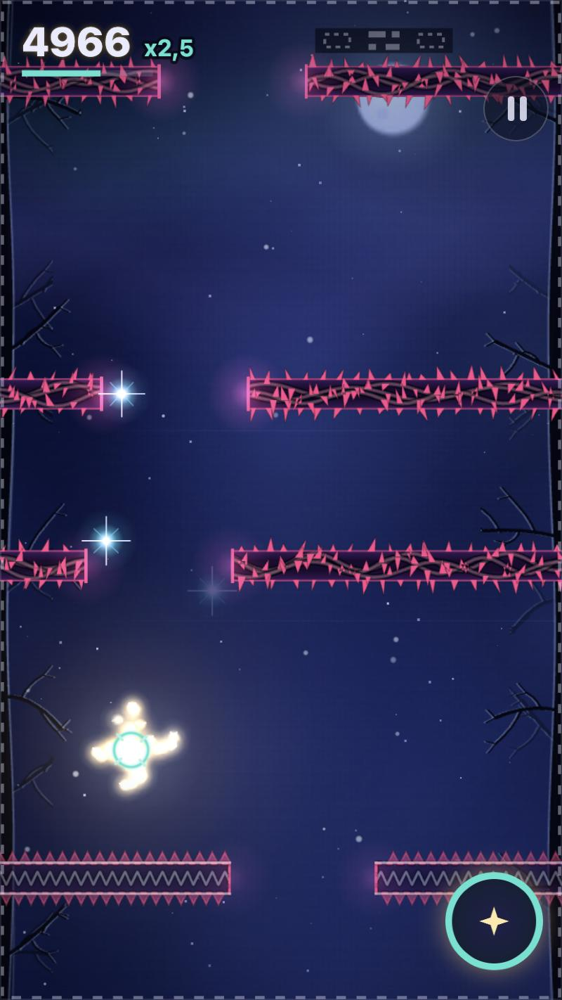

# GLOAM

**A lantern, a swarm of fireflies, a night that keeps getting darker.** A game of skill and nerve in the browser: guide the swarm through the brambles, graze danger to build your combo, and last as long as you can.

### ▶ [Play GLOAM](https://malikchopa.github.io/gloam/)

*In the browser, no install, no account, no ads, no purchase. On a phone (portrait), a tablet or a computer. The game itself is in French and English (`?lang=en`, or the setting).*  ·  [Version française](README.md)

<table>
  <tr>
    <td></td>
    <td></td>
    <td></td>
    <td></td>
  </tr>
</table>

## What is it?

You are a lantern. A swarm of fireflies follows you. The night scrolls faster and faster. There is always a gap in the bramble walls, but never much room to spare.

- **One hand is enough**: the lantern follows your finger, your mouse or your arrow keys. One more gesture fires the **flare**: it drives off predators, then takes a while to come back.
- **Grazing pays**: passing very close to a danger (a "close call") raises your **combo** and multiplier. Playing it safe scores little.
- **The night changes**: four acts in a row: the **Edge**, the **Marsh** (pulsing brambles), the **Peaks** (lightning, announced by a line that charges up) and the **Deep night** (gusts, more bats and moths, a slower flare).
- **Barrages**: from act III on, chains of walls and traps are **announced before they start** (a "Barrage!" banner, a preview of the gaps at the top of the screen). Getting through one without losing a single firefly makes it "perfect".
- **Rare helpers**: the **cocoon** (absorbs the next hit) and the **ember** (recharges the flare at once). Every run starts with a 10-second cocoon.
- **Death shows your result immediately, and you retry with one gesture.** No loading screen, no lives to wait for.
- **Daily challenge**: the same night for everyone (the seed is the date, in UTC). Your best try of the day follows you as a **ghost**. **Free play**: a random seed. This version has no online leaderboard: the daily-challenge ranking is your own device's.
- **Collection**: 5 flames and 5 firefly sets to unlock through mastery, 20 achievements and a statistics screen.
- **Share** your result in one tap, as text.
- **Sound and music generated by code**: no audio files. The music rises with the night.
- **Works offline** after the first visit, and can be installed on the home screen.
- **French and English.**
- **Your game stays in your browser**, no account; nothing is sent anywhere.

## Controls

| | Mouse | Touch | Keyboard | Gamepad |
|---|---|---|---|---|
| Steer the lantern | follows the pointer | drag (the lantern sits a little above your finger, adjustable) | arrows, or Z Q S D / W A S D | left stick or d-pad |
| Flare | click | short tap, second finger or the round button | Space | A button |
| Pause | ⏸ button | ⏸ button | Esc or P | |
| Retry | "Rejouer" (Retry) button | "Rejouer" (Retry) button | Space or Enter | A button |

The game pauses by itself when the window loses focus.

Settings: sound, volume, music, vibration (mobile), ghost, reduced effects, colour-blind mode, language, touch offset, nickname.

## Accessibility (what is really there)

- **Colour-blind mode**: a separate palette (Okabe-Ito colours), chosen in the settings; dangers also have distinct shapes (brambles, lightning, wings).
- **Reduced effects** (a setting; the game also follows the system's "reduce motion" preference): less shaking, fewer particles, less flashing.
- **The whole game works with a keyboard**, a mouse or a finger; important announcements (acts, barrages, nickname errors) are placed in regions read by screen readers.
- **Automatic pause** when you leave the window, with no brutal catch-up when you come back.

## Run it locally

This repository contains the game exactly as it is served (no build step). Start any static file server at the root of the repository, for example:

```
python3 -m http.server 8000
```

then open `http://localhost:8000/`. You need a recent browser (Canvas 2D, ES modules, WebAudio); opening `index.html` straight from disk does not work (ES modules).

Useful URL parameters: `?seed=abc123` (your own seed), `?lang=en`, `?cb=1` (colour-blind), `?fx=0` (reduced effects).

The code published here is the "stripped" version: comments and indentation removed to save weight (about 165 KB compressed, an estimate).

## Credits

A game by MalikChopa.

No third-party material: no library, no font to download (system fonts), no audio file, no game image (the scenery, the lantern, the fireflies, the brambles and the sounds are drawn and synthesised by the code).

The game was designed, programmed and tested by Claude (Anthropic), an AI assistant, at MalikChopa's request; the design choices were delegated to it.

## Licences

- **Code**: [MIT](LICENSE). It includes the programs that draw the scenery, the lantern and the fireflies, and that synthesise the sounds and the music.
- **Icons and screenshots**: [CC BY 4.0](LICENSE-ART), © MalikChopa. If you reuse them, credit: "GLOAM — artwork © MalikChopa, CC BY 4.0, https://creativecommons.org/licenses/by/4.0/".
- **Third-party material**: none.
