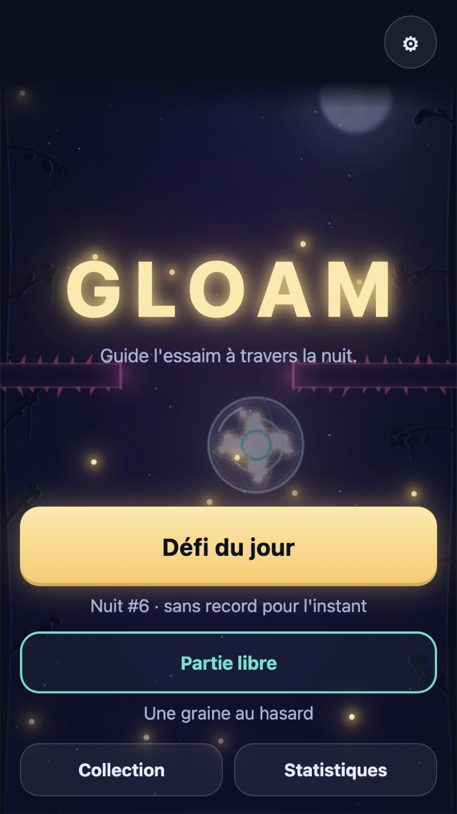
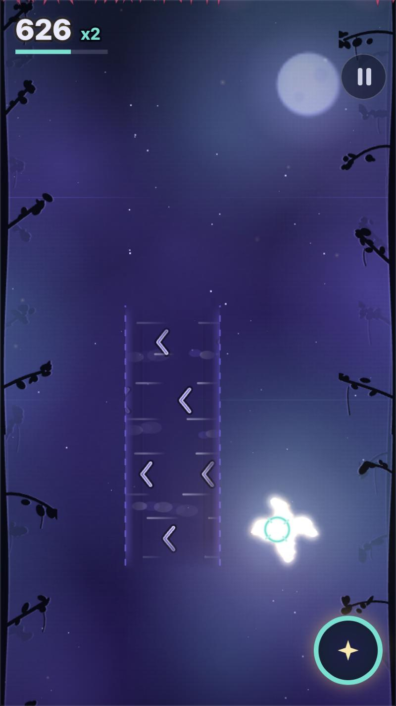
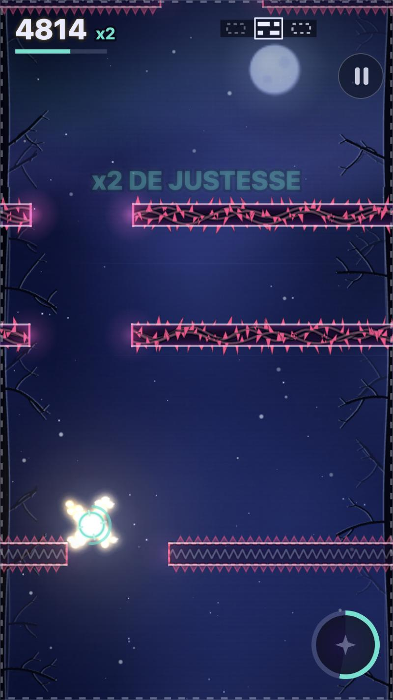
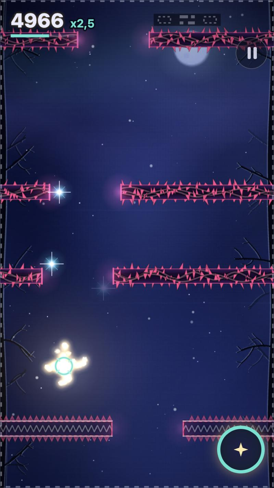

# GLOAM

**Une lanterne, un essaim de lucioles, une nuit à traverser.** Un jeu d'adresse et de sang-froid dans le navigateur : guide l'essaim à travers les ronces, frôle le danger pour monter ton combo, et tiens le plus longtemps possible.

### ▶ [Jouer à GLOAM](https://malikchopa.github.io/gloam/)

*Dans le navigateur, sans installation, sans compte, sans pub, sans achat. Sur téléphone (en portrait), tablette ou ordinateur.*  ·  [English version](README.en.md)

<table>
  <tr>
    <td></td>
    <td></td>
    <td></td>
    <td></td>
  </tr>
</table>

## C'est quoi ?

Tu es une lanterne. Un banc de lucioles te suit. La nuit défile de plus en plus vite. Il y a toujours une ouverture dans les murs de ronces, mais jamais beaucoup de marge.

- **Une seule main** : la lanterne suit ton doigt, ta souris ou tes flèches. Un geste de plus, et c'est l'**éclat** : il repousse les prédateurs, puis il met un moment à revenir.
- **Frôler, c'est payer** : passer tout près d'un danger (« de justesse ») monte le **combo** et le multiplicateur. Jouer prudemment rapporte peu.
- **La nuit change** : quatre actes qui se suivent : la **Lisière**, le **Marais** (ronces qui pulsent), les **Cimes** (la foudre, annoncée par une ligne qui se charge) et la **Nuit profonde** (bourrasques, plus de chauves-souris et de phalènes, éclat plus lent à revenir).
- **Des salves** : à partir de l'acte III, des enchaînements de murs et de pièges sont **annoncés avant de commencer** (bandeau « Salve ! », aperçu des ouvertures en haut de l'écran). Une salve traversée sans perdre une luciole est « parfaite ».
- **Des coups de pouce rares** : le **cocon** (absorbe le prochain coup) et la **braise** (recharge l'éclat tout de suite). Chaque partie commence avec un cocon de 10 s.
- **Mort = résultat tout de suite, rejouer d'un geste.** Pas d'écran de chargement, pas de vies à attendre.
- **Défi du jour** : la même nuit pour tout le monde (la graine est la date, en UTC). Ton meilleur essai du jour te suit en **fantôme**. **Partie libre** : une graine au hasard.
- **Collection** : 5 flammes et 5 jeux de lucioles à débloquer par la maîtrise, 20 hauts faits et un écran de statistiques.
- **Partager** ton résultat en un tap, en texte.
- **Sons et musique générés par le code** : aucun fichier audio. La musique monte avec la nuit.
- **Hors ligne** après la première visite, et installable sur l'écran d'accueil.
- **Français et anglais.**
- **Ta partie reste dans ton navigateur**, sans compte ; rien n'est envoyé nulle part.

## Commandes

| | Souris | Tactile | Clavier | Manette |
|---|---|---|---|---|
| Guider la lanterne | suit le pointeur | glisser (la lanterne se place un peu au-dessus du doigt, réglable) | flèches, ou Z Q S D / W A S D | stick gauche ou croix |
| Éclat | clic | tap court, deuxième doigt ou bouton rond | Espace | bouton A |
| Pause | bouton ⏸ | bouton ⏸ | Échap ou P | |
| Rejouer | bouton « Rejouer » | bouton « Rejouer » | Espace ou Entrée | bouton A |

Le jeu se met en pause tout seul quand la fenêtre perd le focus.

Réglages : son, volume, musique, vibrations (mobile), fantôme, effets réduits, mode daltonien, langue, décalage tactile, pseudo.

## Accessibilité (ce qui est réellement là)

- **Mode daltonien** : une palette à part (couleurs Okabe-Ito), choisie dans les réglages ; les dangers ont aussi des formes distinctes (ronces, éclairs, ailes).
- **Effets réduits** (réglage, et le jeu suit aussi la préférence « mouvement réduit » du système) : moins de tremblements, de particules et de clignotements.
- **Tout le jeu au clavier**, à la souris ou au doigt ; les annonces importantes (actes, salves, erreurs de pseudo) sont placées dans des zones lues par les lecteurs d'écran.
- **Pause automatique** quand on quitte la fenêtre, pas de rattrapage brutal au retour.

## Jouer en local

Ce dépôt contient le jeu tel qu'il est servi (sans étape de construction). Lance n'importe quel serveur de fichiers statiques à la racine du dépôt, par exemple :

```
python3 -m http.server 8000
```

puis ouvre `http://localhost:8000/`. Il faut un navigateur récent (Canvas 2D, modules ES, WebAudio) ; ouvrir `index.html` directement depuis le disque ne marche pas (modules ES).

Paramètres d'adresse utiles : `?seed=abc123` (une graine à toi), `?lang=en`, `?cb=1` (daltonien), `?fx=0` (effets réduits).

Le code publié ici est la version « rognée » : commentaires et indentation retirés pour alléger les fichiers (environ 165 Ko une fois compressés, estimation).

## Ce qui n'est pas vérifié

Le jeu a été essayé par plus de 600 tests automatiques (dont le rejeu de parties enregistrées dans un navigateur) et dans le navigateur d'un seul ordinateur. Tout le reste est **non vérifié** :

- **les vrais téléphones** : seulement l'émulation d'un écran de téléphone sur ordinateur ;
- **Safari et Firefox** (donc Mac, iPhone) : non essayés ;
- **la manette** : jamais essayée sur une vraie manette ;
- **les sons et la musique** : mesurés (niveaux, saturation) mais **jamais écoutés** par une personne ;
- **la difficulté** : jugée avec des joueurs automatiques (bots), pas avec des humains. Elle sera peut-être trop dure, ou trop facile ;
- **la fluidité sur un appareil modeste** : mesurée sur un seul ordinateur récent ;
- **les lecteurs d'écran** : non essayés ;
- **la photosensibilité** : les clignotements sont limités par construction, mais cela n'a pas été évalué par un spécialiste.

Cette version publiée n'a **pas de classement en ligne** : le classement du défi du jour est celui de ton appareil.

## Crédits

Un jeu de MalikChopa.

Aucun élément tiers : pas de bibliothèque, pas de police à télécharger (les polices du système), pas de fichier audio, pas d'image de jeu (les décors, la lanterne, les lucioles, les ronces et les sons sont dessinés et synthétisés par le code).

Le jeu a été conçu, programmé et testé par Claude (Anthropic), un assistant d'intelligence artificielle, à la demande de MalikChopa, qui lui a délégué les choix de conception.

## Licence

Pas encore de licence : **tous droits réservés** pour le moment.
